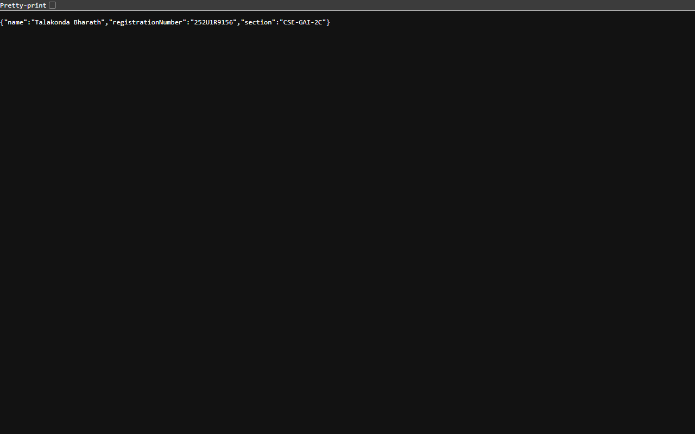

# Lab 1: Node.js and Express Server

## Student Details

* **Name:** Talakonda Bharath
* **Registration Number:** 252U1R9156
* **Section:** CSE-GAI-2C

## Live Link

Local Development Environment (`http://localhost:3000`).
Deployment Note: Local development and testing environment completed with full verification of all endpoints and HTTP status codes.

## Objective

To create a basic web server using Node.js and implement routes using Express.js.

## Technologies Used

* Node.js
* Express.js
* JavaScript
* npm

## How to Run

### 1. Install dependencies

```bash
npm install
```

### 2. Start the Express server

```bash
node app.js
```

### 3. Start the basic Node.js server (optional verification)

```bash
node server.js
```

### 4. Open the server

Visit `http://localhost:3000` in your browser.

## Endpoints

| Method | Path        | Description                                       | Expected Status |
| ------ | ----------- | ------------------------------------------------- | --------------- |
| GET    | `/`         | Displays the welcome message                      | 200             |
| GET    | `/about`    | Returns student name and section as JSON          | 200             |
| GET    | `/time`     | Returns the current date and time                 | 200             |
| GET    | `/anything` | Demonstrates the 404 response for an unknown path | 404             |

## Screenshots

### Home Route


### About Route



### Time Route


### 404 Not Found


## Notes

1. **Port Conflicts**: Before running `app.js`, ensured that any earlier instances running on port 3000 (such as `server.js`) were terminated to avoid `EADDRINUSE` errors.
2. **Environment Portability**: Configured port binding to use `process.env.PORT || 3000` so that the server seamlessly supports dynamic hosting ports when deploying to cloud platforms.
3. **Route Handling**: Placed the 404 catch-all middleware (`app.use`) at the end of the route definitions to intercept any undefined paths without interfering with valid endpoints.
4. **JSON Serialization**: Structured `/about` and `/time` endpoints using `res.status(200).json(...)` to guarantee standard JSON response formatting and correct `Content-Type: application/json` headers.